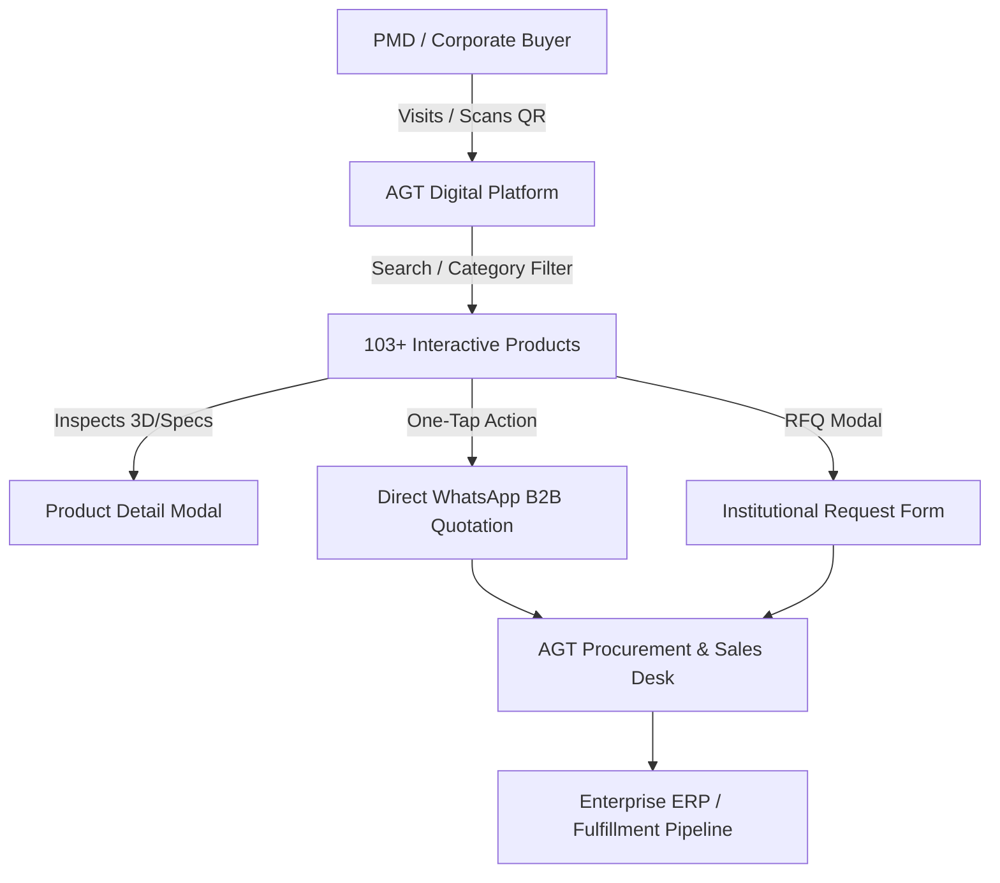
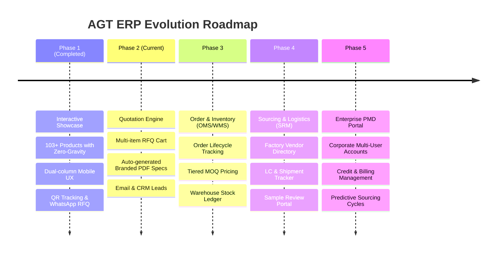

# Abdullah Global Trade (AGT) — Enterprise Platform & ERP Roadmap

> **"FROM VISION TO VALUE"**  
> *Connecting Business | Building Partnerships | Delivering Growth*  
> **Official Live Production URL:** [https://abdullahglobaltrade.netlify.app](https://abdullahglobaltrade.netlify.app)  
> **Deployment Infrastructure:** Netlify Edge CDN (`netlify-repo` on GitHub)

---

## 📑 Table of Contents
1. [Executive Overview & Business Domain](#1-executive-overview--business-domain)
2. [3-Layer Operating Architecture](#2-3-layer-operating-architecture)
3. [Technology Stack & Performance Standard](#3-technology-stack--performance-standard)
4. [Enterprise B2B ERP Roadmap (Phased Evolution)](#4-enterprise-b2b-erp-roadmap-phased-evolution)
5. [Catalog Data & Product Schema Specification](#5-catalog-data--product-schema-specification)
6. [Automated Asset & Image Processing Pipeline](#6-automated-asset--image-processing-pipeline)
7. [Repository File Map & Component Directory](#7-repository-file-map--component-directory)
8. [Standard Operating Procedures (SOPs)](#8-standard-operating-procedures-sops)
9. [Deployment & Git Governance](#9-deployment--git-governance)

---

## 1. Executive Overview & Business Domain

### 1.1 Company Profile
**Abdullah Global Trade (AGT)** is a premier B2B corporate sourcing, promotional merchandise, and institutional gifting agency based in Bangladesh. 

### 1.2 Target Audience & Clients
- **Pharmaceutical Product Management Departments (PMDs):** Sourcing high-utility promotional gifts for doctors, medical conferences, brand campaigns, and scientific symposiums.
- **Corporate Institutions & Financial Brands:** Banks, telecoms, conglomerates, and multinational corporations seeking premium corporate kits, executive onboarding packages, and annual holiday gifts.
- **Custom Branding & Customization:** Direct laser engraving, UV printing, embossed packaging, and bespoke corporate branding.

### 1.3 Strategic Purpose of This Platform
The AGT digital platform bridges the gap between high-volume international sourcing (China, regional manufacturers) and local corporate decision-makers. It replaces static, outdated PDF catalogs with a **fast, zero-gravity interactive 3D/2D digital catalog**, direct WhatsApp quotation triggers, and real-world QR tracking.



---

## 2. 3-Layer Operating Architecture

To maintain strict determinism, avoid LLM errors, and ensure production stability, this repository operates under a strict **3-Layer Architecture**:

| Layer | Responsibility | Directory Location | Description |
| :--- | :--- | :--- | :--- |
| **Layer 1: Directive** | SOPs & Intent | `directives/` | Plain Markdown instructions describing workflows, parameters, error limits, and operational rules (e.g. `2d_floating_pipeline.md`). |
| **Layer 2: Orchestration** | Intelligent Decision Making | Agent / AI / Developer | Decides which tools to invoke, validates inputs/outputs, handles exceptions, and updates directives. |
| **Layer 3: Execution** | Deterministic Code | `execution/` | Standalone, tested Node.js/Python scripts handling heavy lifting (AI background stripping, sharp image resampling, batch operations). |

---

## 3. Technology Stack & Performance Standard

### 3.1 Core Technologies
- **Framework:** Next.js 16 (App Router, Turbopack, React 19)
- **Styling:** Tailwind CSS (Custom Luxury Ivory & Navy-Gold Enterprise Theme)
- **Animation Physics:** GSAP (GreenSock) — Zero-Gravity Floating, Synchronized Ground Shadows, Interactive 3D Perspective Tilt
- **Image Processing Engine:** Sharp (libvips C++ backend) with Lanczos3 sinc resampling
- **Hosting & CDN:** Netlify Edge Network (Static/SSR via `@netlify/plugin-nextjs`)

### 3.2 Performance & Visual Standard ("Clean & Diligent")
- **3x Retina Sharpness:** All assets are constrained to max 850px with `quality: 90` and micro-sharpening, ensuring razor-sharp edges and clear typography on 4K monitors and Retina mobile screens without bloating payload size.
- **GSAP Viewport Optimization:** Every `ProductCard` utilizes an `IntersectionObserver` with a 200px root margin. Off-screen cards automatically pause their 60fps physics loop and CSS blur computations, freeing 90% of GPU/CPU resources.
- **Above-The-Fold Priority:** First 8 products receive `priority={true}` for instant loading.
- **Shimmer Skeleton:** Luxury gold-tinted pulse placeholders eliminate blank pop-ins while images load.

---

## 4. Enterprise B2B ERP Roadmap (Phased Evolution)

This roadmap outlines the complete transformation of AGT from an interactive digital showcase into a full-scale, end-to-end B2B Enterprise Resource Planning (ERP) platform.



---

### 🔹 Phase 1: Interactive Showcase & Digital Catalog (COMPLETE ✅)
- **Catalog Manifest:** 103 curated corporate merchandise products across 6 consolidated enterprise categories.
- **Zero-Gravity GSAP Physics:** Seamless 2D DOM-based floating animations with reactive shadow dynamics.
- **Direct B2B Inquiry Routing:** Every product includes serialized codes (`AGT-01` to `AGT-103`) pre-filled into WhatsApp quotation requests.
- **Digital Visiting Card & Analytics:** Integrated corporate business card with high-error-tolerance QR code and scan velocity tracker (`/api/track-scan`).
- **Netlify Edge Deployment:** Zero-budget, ultra-fast global distribution on Netlify.

---

### 🔹 Phase 2: Quotation Engine & Automated Spec Sheets (Q1 2027)
*Objective: Empower PMDs and corporate procurement officers to build custom quotation packages instantly.*

1. **Multi-Item RFQ Builder (B2B Cart):**
   - Allow corporate buyers to select multiple products (e.g., 500 pcs Water Bottle + 1000 pcs Pen Holder).
   - Specify logo requirements (Laser Engraving, Silk Screen, UV Printing).
2. **Instant Branded PDF Generator:**
   - One-click export of an official, client-ready quotation document with AGT letterhead, product specifications, estimated lead times, and terms of service.
3. **Inquiry CRM Pipeline:**
   - Database logging (Supabase / PostgreSQL) for all incoming quote requests.
   - Automated notification triggers to AGT procurement management via Telegram/WhatsApp webhook.

---

### 🔹 Phase 3: Order Management (OMS) & Inventory Ledger (WMS) (Q2 2027)
*Objective: Centralize order tracking, warehouse management, and client approval stages.*

1. **Order Lifecycle Pipeline:**
   - Clear multi-stage status tracker:
     $$\text{Draft} \longrightarrow \text{Sample Approved} \longrightarrow \text{In Production} \longrightarrow \text{Customs Clearance} \longrightarrow \text{Quality Check} \longrightarrow \text{Dispatched}$$
2. **Dynamic Volume Pricing Engine:**
   - Tiered wholesale pricing matrices based on volume:
     - Tier 1: 100 – 499 pcs (Standard B2B Wholesale)
     - Tier 2: 500 – 1,999 pcs (3-5% Institutional Discount)
     - Tier 3: 2,000+ pcs (Direct Factory Sourcing Rate)
3. **Warehouse & Stock Management (WMS):**
   - Central stock ledger tracking physical inventory across local Dhaka warehouses.
   - Low-stock and re-order point alerts for popular recurring corporate gift items.

---

### 🔹 Phase 4: Global Sourcing & Supplier Relationship Management (SRM) (Q3 2027)
*Objective: Streamline international procurement from Chinese & regional factories.*

1. **Vendor Directory & Purchase Orders (PO):**
   - Secure repository of overseas manufacturers, MOQ agreements, and raw material costs.
   - Automated bilingual (English/Chinese) PO generation.
2. **Import & Freight Forwarding Tracker:**
   - Tracking Letter of Credit (LC), Bill of Lading (BL), Port Clearance (Chittagong / Dhaka Air Cargo), and container arrival ETAs.
3. **Digital Sample Approval Portal:**
   - Upload high-resolution 360° videos and photo QC reports of mockups for PMD brand manager sign-off before mass production.

---

### 🔹 Phase 5: Enterprise PMD Portal & Financial ERP (Q4 2027)
*Objective: Multi-tenant client portals for Bangladesh's top pharmaceutical and corporate buyers.*

1. **Corporate Client Dashboard:**
   - Role-Based Access Control (RBAC):
     - **PMD Executive:** Selects designs, requests mockups, submits quantities.
     - **Procurement Officer:** Approves purchase orders and negotiates pricing terms.
     - **Accounts Dept:** Manages VAT challans, invoices, and payment schedules.
2. **Accounting & Tax Compliance:**
   - Automated National Board of Revenue (NBR) compliant VAT (Mushak-6.3) invoice generation.
   - Integration with banking payment gateways and corporate credit term management (e.g., 30-day/60-day credit lines).
3. **Predictive Sourcing AI:**
   - Historical demand forecasting aligned with pharmaceutical promotional calendars (e.g., World Diabetes Day, Cardiology summits, Eid gifting).

---

## 5. Catalog Data & Product Schema Specification

The master catalog resides in `public/data/products.json`. Every product strictly adheres to this contract:

```typescript
interface ProductManifest {
  id: string;               // Unique kebab-case slug (e.g., "rose-in-glass-dome")
  serial: string;           // Business code (e.g., "AGT-84")
  name: string;             // Official commercial product title
  category: B2BCategory;    // Standardized enterprise category
  format: "webp";           // High-efficiency transparent format
  image: {
    url: string;            // Relative public URL (/images/products/[id].webp)
    width: number;          // Native width in pixels
    height: number;         // Native height in pixels
    aspectRatio: number;    // width / height rounded to 3 decimal places
    sizeKb: string;         // Human-readable size (e.g., "65.8 KB")
    hasAlpha: boolean;      // Always true for transparent assets
  };
  animation: {
    engine: "GSAP";
    zeroGravity: boolean;   // Enables continuous floating
    profile: "balanced" | "medium-dense" | "light-buoyant";
    floating: {
      amplitudeY: number;   // Oscillation distance in pixels
      duration: number;     // Half-cycle period in seconds
      ease: string;         // GSAP easing string (e.g., "sine.inOut")
      rotationDriftZ: number;
      rotationDriftX: number;
    };
    shadow: {
      baseBlur: number;
      spread: number;
      minOpacity: number;
      maxOpacity: number;
      scaleRange: [number, number];
    };
    interaction: {
      liftY: number;
      scale: number;
      tiltSensitivity: number;
      duration: number;
      ease: string;
    };
    cssPerspective: string; // Default: "1000px"
    transformOrigin: string;// Default: "center center"
  };
  meta: {
    strippedWith: string;   // Tool name (e.g., "BRIA AI RMBG-1.4")
    optimizedWith: string;  // Tool name (e.g., "sharp libvips")
    createdAt: string;      // ISO timestamp
  };
  bulkDiscount?: string;    // B2B commercial terms (e.g., "3-5% discount on higher quantity")
  price?: number;           // Reserved for future custom quote tiers (default: on request)
}
```

### 5.1 Standardized 6 Enterprise Categories
1. `Kitchen & Appliances` (Electric kettles, vacuum flasks, food grinders, cookware)
2. `Electronics & Gadgets` (LED lamps, smart wireless doorbells, emergency lights, humidifiers)
3. `Home & Lifestyle` (Preserved rose glass domes, wooden tissue boxes, decorative gifts)
4. `Food & Beverages` (Premium teas, mountain honeys, traditional pickles, drink powders)
5. `Sports & Fitness` (Tournament badminton nets, shuttlecocks, body exerciser wheels)
6. `Health & Personal Care` (BP monitors, blood glucose meters, nebulizers, hot/cold packs)

---

## 6. Automated Asset & Image Processing Pipeline

When adding new products, AGT employs a specialized AI and sharp pipeline to achieve **retina sharpness with minimal byte weight**:

```
[Raw Photo / Camera JPG] 
         │
         ▼
[Step 1: BRIA RMBG-1.4 AI]  ──► Background removed to transparent alpha PNG
         │
         ▼
[Step 2: Sharp libvips]     ──► .trim() bounding box + Lanczos3 downsample (max 850px)
         │
         ▼
[Step 3: Micro-Sharpen]     ──► .sharpen({ sigma: 0.5, m1: 0.5, m2: 2.0 })
         │
         ▼
[Step 4: WebP Encoder]      ──► quality: 90, effort: 4 ──► Output: 25KB–65KB WebP
         │
         ▼
[Step 5: Catalog Update]    ──► Appended to public/data/products.json with GSAP physics
```

---

## 7. Repository File Map & Component Directory

```
├── app/
│   ├── api/
│   │   └── track-scan/
│   │       └── route.js           # Lightweight QR scan tracking endpoint
│   ├── favicon.ico
│   ├── globals.css                # Enterprise design tokens & gold gradients
│   ├── layout.jsx                 # SEO meta, OpenGraph tags, Google Analytics 4
│   └── page.jsx                   # Master catalog page layout & modal controllers
├── components/
│   ├── CatalogGrid.jsx            # Dynamic category filter, search & 1/2 col toggle
│   ├── FloatingWhatsApp.jsx       # Floating corporate WhatsApp communication trigger
│   ├── Footer.jsx                 # Enterprise footer with trade credentials
│   ├── Navbar.jsx                 # Sticky luxury header with brand logo & quote button
│   ├── ProductCard.jsx            # GSAP zero-gravity card with IntersectionObserver & Shimmer
│   ├── ProductDetail.jsx          # Spec modal, branding capabilities & instant quote
│   ├── QRAnalytics.jsx            # Real-world scan velocity & device breakdown
│   ├── QuoteModal.jsx             # Institutional RFP inquiry modal
│   └── VisitingCard.jsx           # 3D flippable digital visiting card with QR download
├── directives/
│   └── 2d_floating_pipeline.md    # Layer 1 SOP for asset processing
├── execution/
│   ├── batch_process_2d.js        # Batch AI background removal runner
│   ├── optimize_all_images.js     # High-fidelity parallel Lanczos3 image optimizer
│   ├── process_2d_product.js      # Single-product AI processing script
│   └── update_new_products.js     # Serial & price manifest batch updater
├── public/
│   ├── data/
│   │   └── products.json          # Master B2B Catalog manifest (103 products)
│   └── images/
│       ├── logo.png               # Official brand identity
│       └── products/              # Transparent WebP assets (103 products)
├── netlify.toml                   # Netlify build & deployment configuration
├── next.config.js                 # Production headers (HSTS, CSP, Cache-Control)
├── package.json                   # Dependencies (Next 16.4.3, React 19, GSAP 3, Sharp)
├── PROJECT.md                     # This document (Master Architecture & ERP Roadmap)
└── README.md                      # Quick repository guide
```

---

## 8. Standard Operating Procedures (SOPs)

### 8.1 Adding a New Product Manually
1. Place a transparent `.webp` image in `public/images/products/[product-id].webp`.
2. Open `public/data/products.json`.
3. Add the new product object at the **very beginning (first item, Z-A order)** with the next sequential code (e.g., `AGT-104`). New products must always be added first, never at the end.
4. Select one of the 6 canonical categories.
5. Save and run `npm run build` to verify syntax.

### 8.2 Adding a New Product via AI Automated Script
If you have a raw camera photo with a background:
```bash
# 1. Place raw image in .tmp/
cp /path/to/my-photo.jpg .tmp/leather-diary.jpg

# 2. Run the Layer 3 execution pipeline (automatically prepends to top of products.json)
node execution/process_2d_product.js \
  --input ".tmp/leather-diary.jpg" \
  --id "executive-leather-diary" \
  --name "Executive PU Leather Diary & Pen Set" \
  --category "Home & Lifestyle"
```

### 8.3 Running the Batch Image Optimizer
To re-optimize all 103+ images to 3x Retina standards at any time:
```bash
node execution/optimize_all_images.js
```

---

## 9. Deployment & Git Governance

The project maintains two git remotes:
1. **`netlify-repo`** (Primary Live Production): `https://github.com/TalhaTamim45/agt-platform-e9b12.git`
   - Connected directly to Netlify Edge CDN.
   - Pushing to `netlify-repo master` triggers an instantaneous production build.
2. **`origin`** (Secondary Backup): `https://github.com/TalhaTamim45/agt-platform.git`

### Standard Deployment Command:
```bash
# 1. Verify build passes without errors
npm run build

# 2. Stage and commit changes
git add -A
git commit -m "feat: [describe your changes]"

# 3. Push to Netlify Live Repository
git push netlify-repo master

# 4. Push to Backup Origin Repository
git push origin master
```

---
*Maintained by the Abdullah Global Trade Engineering & Product Operations Team.*  
*Last Updated: October 2026*
